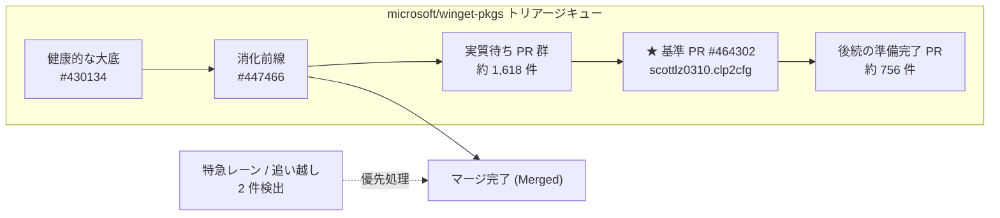

# Winget Observatory Dashboard

> [!NOTE]
> **最終更新日時 (JST)**: 2026-11-06 23:22:44  
> **基準 PR**: [#464302 (New package: scottlz0310.clp2cfg version 0.1.0)](https://github.com/microsoft/winget-pkgs/pull/464302)

## 1. 現在のキュー状況・メトリクス

| 指標                        | 現在値                              | 説明                                                       |
| --------------------------- | ----------------------------------- | ---------------------------------------------------------- |
| **消化前線**                | **#447466** (2026-10-06 10:13 起票) | FIFO 列の先頭（直近に正常マージされた最も古いオープン PR） |
| **実質待ち件数**            | **1,618 件**                        | 前線〜自 PR 間で生存している健康なオープン PR 件数         |
| **全期間累積待ち**          | 2,133 件                            | 過去の未消化・保留分を含む累積 PR 番号差                   |
| **後続の準備完了 PR**       | 756 件                              | 自 PR より後ろに並んでいる健康なオープン PR 件数           |
| **通算待機日数 (Total)**    | **9.07 日**                         | 起票日時からの経過日数                                     |
| **レビュー待ち時間 (Turn)** | **9.07 日**                         | 最新コミットからの経過日数（モデレーター側滞留時間）       |
| **条件整流後待機 (Ready)**  | 9 日                                | 必須ラベル整流・CI 通過からの待機日数                      |

## 2. キュー構造の視覚化

## 3. 過去 30 日間マージ実績との統計比較

| メトリクス                              | 実績 中央値 (Median) | 実績 75%点 (P75) | あなたの待機 | 状況判定                |
| --------------------------------------- | -------------------- | ---------------- | ------------ | ----------------------- |
| **通算日数 (作成〜マージ)**             | 51.9 日              | 56.97 日         | **9.07 日**  | 中央値以内（順調）      |
| **レビュー待ち (最新コミット〜マージ)** | 6.71 日              | 6.71 日          | **9.07 日**  | 長めの滞留（75%点付近） |
| **条件成立後 (Ready〜マージ)**          | 1 日                 | 2.09 日          | **9 日**     | -                       |

## 4. キュー境界探索スナップショット

### 4-1. 健康的な大底 (Healthy Bottom)

CI 通過・エラーなしの健康体で、現在最も古いオープン PR（正当な FIFO の先頭候補）：

| PR                                                              | 起票日時 (JST)   | 最終更新 (JST)   | タイトル                                           |
| --------------------------------------------------------------- | ---------------- | ---------------- | -------------------------------------------------- |
| [#430134](https://github.com/microsoft/winget-pkgs/pull/430134) | 2026-09-05 20:36 | 2026-11-04 01:56 | ruslanlap.PowerToysRun-VideoDownloader version ... |
| [#430799](https://github.com/microsoft/winget-pkgs/pull/430799) | 2026-09-07 07:53 | 2026-11-04 02:04 | New package: LiamCottle.ReticulumMeshChat versi... |
| [#431818](https://github.com/microsoft/winget-pkgs/pull/431818) | 2026-09-09 07:35 | 2026-11-05 04:36 | New package: PlummersSoftware.TMOG version 1.0.1   |

### 4-2. 特急レーン・追い越し (Express Lane)

基準 PR 起票日以降に作成され、すでにマージされた PR：

| PR                                                              | 起票日時 (JST)   | マージ/更新 (JST) | タイトル                                           |
| --------------------------------------------------------------- | ---------------- | ----------------- | -------------------------------------------------- |
| [#469854](https://github.com/microsoft/winget-pkgs/pull/469854) | 2026-11-03 16:59 | 2026-11-06 05:11  | New version: Mikrotik.Flashfig version 7.25.1      |
| [#466212](https://github.com/microsoft/winget-pkgs/pull/466212) | 2026-10-30 11:44 | 2026-11-03 02:21  | New package: wanghongyu666qiang.AskBridge versi... |

### 4-3. 遭難・放置の底 (Stale Bottom)

健康体の中で更新日時が最も古く、完全に止まっている PR：

| PR                                                              | 起票日時 (JST)   | 最終更新 (JST)   | タイトル                                     |
| --------------------------------------------------------------- | ---------------- | ---------------- | -------------------------------------------- |
| [#449320](https://github.com/microsoft/winget-pkgs/pull/449320) | 2026-10-09 04:39 | 2026-10-09 05:54 | New package: Foxmayn.ffc version 1.16.1      |
| [#449314](https://github.com/microsoft/winget-pkgs/pull/449314) | 2026-10-09 04:13 | 2026-10-09 07:46 | New package: Rootform.Rootform version 0.2.0 |
| [#449390](https://github.com/microsoft/winget-pkgs/pull/449390) | 2026-10-09 07:57 | 2026-10-09 08:42 | Qisuk.ShortCutTool version 1.1.0             |

## 5. 直近の消化推移履歴

| 記録日時 (JST)      | 消化前線 | 実質待ち | 累積待ち | 通算待機 | レビュー待ち | コミット数 |
| ------------------- | -------- | -------- | -------- | -------- | ------------ | ---------- |
| 2026-11-06 23:22:44 | #447466  | 1,618 件 | 2,133 件 | 9.07 日  | 9.07 日      | 1          |
| 2026-11-06 23:21:47 | #447466  | 1,618 件 | 2,133 件 | 9.06 日  | 9.06 日      | 1          |
| 2026-11-06 20:02:19 | #447466  | 1,620 件 | 2,136 件 | 8.93 日  | 8.93 日      | 1          |
| 2026-11-06 19:14:04 | #447466  | 1,618 件 | 2,133 件 | 8.89 日  | 8.89 日      | 1          |
| 2026-11-06 18:22:14 | #447466  | 1,622 件 | 2,136 件 | -        | 8.79 日 (旧) | -          |

---

_このドキュメントは [winget-observatory](https://github.com/scottlz0310/winget-observatory) の自動観測ワークフローにより定期更新されます。_
